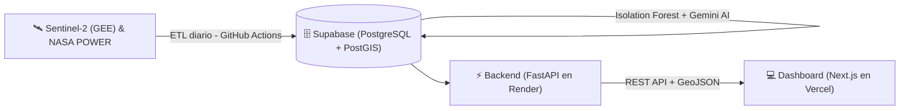

# 🌱 AgroLens AI

Plataforma full-stack de monitoreo agrícola inteligente que integra imágenes satelitales (**Sentinel-2** vía Google Earth Engine), datos agroclimáticos (**NASA POWER**) y detección de anomalías con **Machine Learning e Inteligencia Artificial** para generar alertas tempranas y diagnósticos agronómicos interactivos.

[](https://nextjs.org/)
[](https://fastapi.tiangolo.com/)
[](https://supabase.com/)
[](https://earthengine.google.com/)
[](https://ai.google.dev/)
[](https://render.com/)
[](https://vercel.com/)

---

## 🔗 Enlaces del Proyecto

- **Demo en vivo (Frontend):** [https://agrolens-ai-ochre.vercel.app/](https://agrolens-ai-ochre.vercel.app/)
- **API en producción (Backend):** [https://agrolens-ai-bs39.onrender.com](https://agrolens-ai-bs39.onrender.com)
- **Documentación interactiva de la API:** [https://agrolens-ai-bs39.onrender.com/docs](https://agrolens-ai-bs39.onrender.com/docs)

---

## 📐 Arquitectura del Sistema



### Componentes Clave

1. **Ingesta automatizada (GitHub Actions):**  
   Pipeline programado (cron diario a las 09:00 UTC) que extrae índices de vegetación e hídricos (**NDVI**, **NDWI**) desde Google Earth Engine y variables agroclimáticas (temperaturas, precipitaciones, radiación solar) desde la API de NASA POWER.
2. **Detección de anomalías y Diagnóstico con IA:**  
   Un modelo no supervisado (**Isolation Forest**) analiza desviaciones en la evolución de los índices de cada lote en relación con las condiciones climáticas. Si se detecta una anomalía significativa, la **API de Google Gemini** genera un diagnóstico técnico agronómico claro, contextualizado y accionable.
3. **API REST Geoespacial (FastAPI en Render):**  
   Servicio backend que procesa y sirve los polígonos de las parcelas en formato **GeoJSON**, provee series temporales consolidadas y gestiona el ciclo de vida de las alertas mediante endpoints REST.
4. **Dashboard Interactivo (Next.js en Vercel):**  
   Interfaz moderna con soporte para mapas interactivos (**Leaflet** / **React-Leaflet**), gráficos de evolución temporal (**Recharts**) y una consola de triage para que los ingenieros agrónomos gestionen el estado de las alertas en tiempo real.

---

## 🛠️ Stack Tecnológico

| Capa | Tecnologías |
|---|---|
| **Frontend** | [Next.js 16](https://nextjs.org/) (App Router), [React 19](https://react.dev/), [TypeScript](https://www.typescriptlang.org/), [Tailwind CSS v4](https://tailwindcss.com/), [React-Leaflet](https://react-leaflet.js.org/), [Recharts](https://recharts.org/), [Lucide React](https://lucide.dev/) |
| **Backend** | [Python 3.13](https://www.python.org/), [FastAPI](https://fastapi.tiangolo.com/), [Uvicorn](https://www.uvicorn.org/), [Psycopg2](https://www.psycopg.org/), [Pydantic](https://docs.pydantic.dev/) |
| **Base de Datos** | [PostgreSQL](https://www.postgresql.org/) con extensión geoespacial [PostGIS](https://postgis.net/) alojado en [Supabase](https://supabase.com/) |
| **Data & Machine Learning** | [Google Earth Engine](https://earthengine.google.com/), [NASA POWER API](https://power.larc.nasa.gov/), [Pandas](https://pandas.pydata.org/), [Scikit-Learn](https://scikit-learn.org/), [Google Gemini API](https://ai.google.dev/) (`google-genai`) |
| **DevOps & CI/CD** | [GitHub Actions](https://github.com/features/actions) (ejecución diaria automatizada), [Render](https://render.com/) (Web Service Backend), [Vercel](https://vercel.com/) (Hosting Frontend) |

---

## 📁 Estructura del Proyecto

```text
agrolens-ai/
├── .github/workflows/
│   └── daily_etl.yml          # Workflow de GitHub Actions (ETL diario + Detector de alertas)
├── backend/
│   ├── main.py                # Endpoints FastAPI (GeoJSON, series temporales, alertas)
│   └── requirements.txt       # Dependencias livianas para despliegue en Render
├── database/
│   ├── schema.sql             # DDL: tablas PostGIS, clientes, lotes, clima, índices y alertas
│   └── seed_lotes.sql         # Datos iniciales de parcelas de prueba
├── frontend/
│   ├── src/
│   │   ├── app/               # Páginas, layout y estilos globales de Next.js
│   │   └── components/        # Componentes reutilizables (Mapa, Gráficos, Alertas)
│   ├── package.json           # Scripts y dependencias de Node.js
│   └── tsconfig.json          # Configuración de TypeScript
├── pipelines/
│   ├── etl_ingesta_agro.py    # Ingesta satelital (Sentinel-2 GEE) y climática (NASA POWER)
│   └── ia_detector_alertas.py # Algoritmo Isolation Forest + Diagnóstico agronómico con Gemini
├── requirements.txt           # Dependencias para ejecución de pipelines locales/CI
└── README.md                  # Documentación del proyecto
```

---

## 🔌 Endpoints de la API

| Método | Endpoint | Descripción |
|---|---|---|
| `GET` | `/` | Health check del servicio |
| `GET` | `/api/lotes` | FeatureCollection GeoJSON con lotes, último NDVI/NDWI y severidad activa |
| `GET` | `/api/lotes/{lote_id}/series?dias=60` | Series temporales climáticas y satelitales del lote solicitado |
| `GET` | `/api/alertas?estado={estado}` | Listado de alertas generadas por IA (filtro: `PENDIENTE`, `EN_REVISION`, `RESUELTA`) |
| `PATCH` | `/api/alertas/{alerta_id}` | Actualización del estado de gestión de una alerta agronómica |

